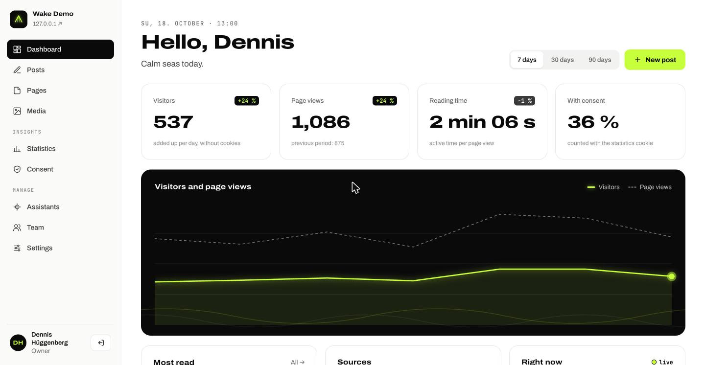
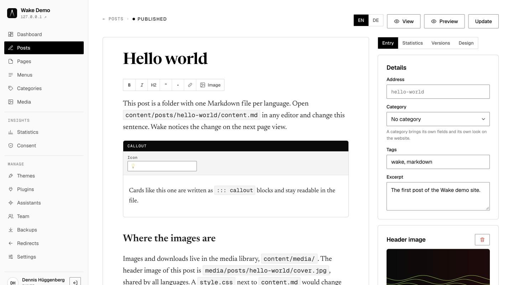
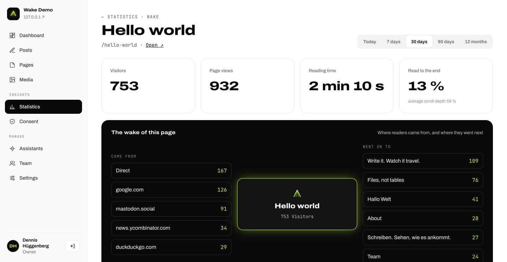
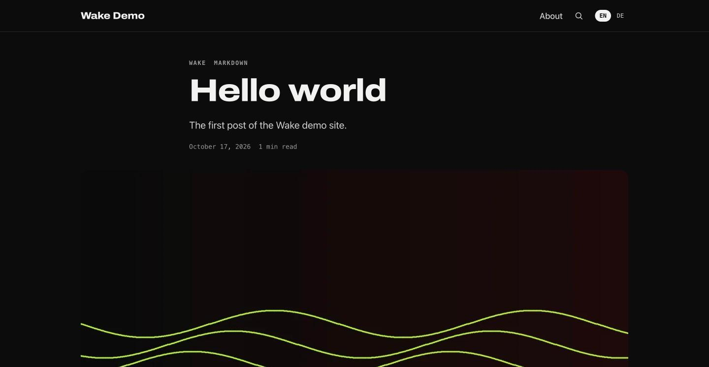

# Wake

**Write it. Watch it travel.**

Wake is a free flat-file CMS built on Laravel. Every post is a Markdown file
you can open in any text editor, and there is no database. Analytics and consent
management are built in, so the dashboard shows what you wrote next to how it
is doing. Wake also ships its own MCP server, which lets AI assistants such as
Claude answer questions about your stats and read, draft and publish posts.

> **Status:** version 1.0 is feature-complete and in testing before its first
> real website. See the [roadmap](docs/project/roadmap.md).



## Why Wake

- **As simple as Kirby.** No database. Content is Markdown with YAML front
  matter, one folder per entry, versionable with Git.
- **As calm as Ghost.** A focused editor and a dashboard you want to open every
  morning.
- **Analytics and consent built in.** Cookieless page view statistics by
  default, more detail only with consent, and a consent banner that treats
  "Decline" the same as "Accept".
- **Made for AI assistants.** A built-in MCP server with scoped tokens.
- **Runs on cheap shared hosting.** No SSH, no cron and no Node on the server.
- **Free.** MIT licensed. There is no paid tier and no pro version.

## What's inside

- **Writing:** an editor that writes Markdown, with cards (callouts, buttons,
  embeds), images by drag and drop, translations, scheduling, versions and a
  history of every change.
- **Statistics:** visitors, sources, campaigns, reading time and read-through
  rate per post, live visitors, AI crawlers, and *the wake* of every post:
  where readers came from and where they went next.
- **Consent:** a banner only when it is needed, two-click embeds, anonymous
  consent records and a ready-made section for your privacy policy.
- **Assistants:** an MCP server for Claude and others, with personal tokens,
  scopes, drafts-only writing and an optional approval mode.
- **Multilingual:** one file per language, translated addresses, `hreflang`,
  feeds and sitemap per language.
- **Fast:** a content index in OPcache and a full page cache that answers before
  Laravel starts.
- **Tide**, a calm default theme, a read-only content API, search, an import
  from Ghost and updates from the panel.

| The editor | The wake of a post | Tide |
|---|---|---|
|  |  |  |

## Quick look

```
wake/       the Laravel application (replaced on update)
site/       your configuration, blueprints and theme
content/    your posts and pages as Markdown files
storage/    accounts, statistics, caches (never public)
public/     the document root
```

A post is a folder with one file per language:

```markdown
---
title: Hello world
status: published
published: 2026-10-17 09:00
tags: [travel]
---

The first paragraph …
```

## Getting started

On a web host: download the ZIP, upload it, point the document root to
`public/`, open `/wake`. Details in
[Install on a web host](docs/getting-started/hosting.md).

On your computer:

```bash
git clone https://github.com/IonFlux84/wake.git my-site
cd my-site
composer --working-dir=wake install
php wake/artisan serve
```

Then open http://localhost:8000, and http://localhost:8000/wake to create your
account. The full guide is in
[docs/getting-started/installation.md](docs/getting-started/installation.md).

## Documentation

Documentation is part of every change in Wake, not something that follows
later. Start at [docs/README.md](docs/README.md).

- [System requirements](docs/getting-started/requirements.md) and
  [installation](docs/getting-started/installation.md)
- [Your first site](docs/getting-started/first-site.md)
- [Build a theme](docs/guides/build-a-theme.md) and the
  [template reference](docs/reference/templates.md)
- [Write a plugin](docs/guides/write-a-plugin.md) and the
  [plugin reference](docs/reference/plugins.md)
- [Connect an AI assistant](docs/guides/connect-an-assistant.md) and the
  [MCP reference](docs/reference/mcp.md)

## Contributing

Wake is built in the open for everyone. Read [CONTRIBUTING.md](CONTRIBUTING.md)
before you open a pull request, and please follow our
[Code of Conduct](CODE_OF_CONDUCT.md). Security issues go to
[SECURITY.md](SECURITY.md), not to the issue tracker.

## License

Wake is open source software licensed under the [MIT license](LICENSE).
